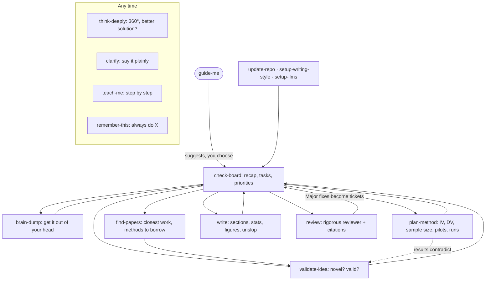

# How Chaky works

**You lead; Chaky suggests.** Say "guide me" (`guide-me`) and Chaky reads your project and **board**, tells you what needs attention, and **suggests** which skill could help. You choose. Inside a task, Chaky just makes the change and tells you in one line ("say *undo* to reverse it"); it asks first only for critical steps (deleting or moving files, freezing the plan, pushing, participants and ethics, spending money, pasting data into free AI chats, submitting).

Work happens in **tickets**; each has a 1-5 priority Chaky sets (you can change it) and a "done when". The paper is a living draft: `write` keeps it in step, and `review` checks it often.

**Two ways to lead:** "you drive" (Chaky suggests the top task each time) or "let me lead" (Chaky shows your top tasks and waits). Either way you pick.

**Every skill takes an optional focus:** `/write abstract`, `/plan-method IV`, `/validate-idea <idea>`, `/find-papers <topic>`, `/review citations`, `/teach-me <topic>`.

**Where things live in your project**
- `components/tickets.md`: the board (destination, fog, tickets)
- `components/current_status.md`: the stage map and plain-English status
- `components/log.md`: decisions, dead ends, pivots (who decided each)
- `components/review.md`: the latest review and its history
- `components/voice.md` and `terms.md`: your writing style and your words
- `AGENTS.md`: the rules every skill follows (and your lab's defaults)
