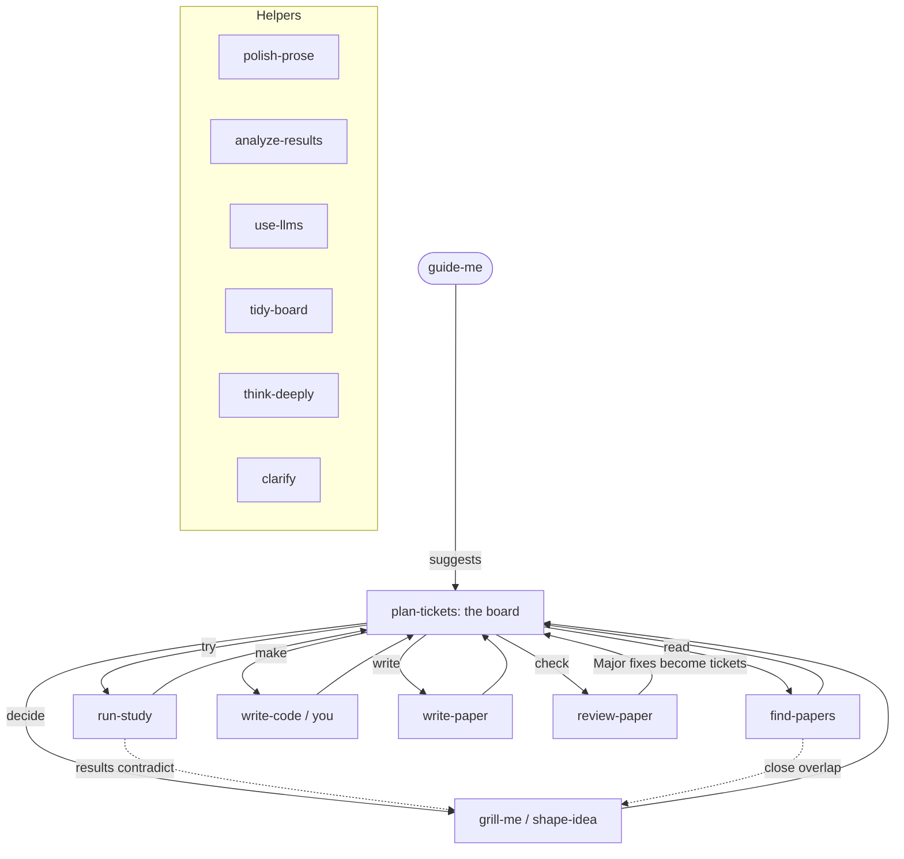

# How Chaky works

Chaky (`guide-me`) is the front door. It reads your project and **board**, tells you what needs attention, and **suggests** which skill could help; you choose. Humans lead. Work happens in **tickets**; each has a 1-5 priority Chaky sets (you can change it) and a "done when" so you know when it is enough. The paper is a living draft: every skill ends by syncing it, and `review-paper` checks it often.

**Two modes:** `assist` (Chaky recommends the top ticket) and `lead` (you steer; Chaky shows the board and answers). Switch any time: "you drive" / "let me lead".

**Where things live in your project**
- `components/tickets.md`: the board (destination, fog, tickets)
- `components/current_status.md`: the stage map and plain-English status
- `components/log.md`: decisions, dead ends, pivots (who decided each)
- `components/review.md`: the latest review and its history
- `AGENTS.md`: the rules every skill follows (and your lab's defaults)
